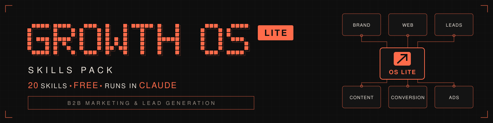

<p align="center">
  
</p>

# Growth OS Lite (`growth-os-skills-lite`)

<p align="center">
  
  
  
  <a href="https://agentskills.io"></a>
  
  
</p>

**Growth OS Lite is 20 free Claude skills for B2B marketing and lead generation, from your ICP and offer to SEO audits, lead magnets, LinkedIn posts and an ads audit, and they all share one description of your business.**

## Key takeaways

- **Runs directly in Claude.** Upload the skills to Claude.ai or Claude Desktop, or install them in Claude Code. No extra tools, accounts or code needed: every skill works with Claude's built-in web search, web reading, and the files you upload.
- **Describe your business once.** Four context files (business profile, ICP, Voice of Customer, offer) are created by interview, and every other skill reads them, so you stop re-briefing Claude.
- **Always asks before it uses an external service.** A few skills can use a connector such as Firecrawl or DataForSEO for better data. They stop and ask first, say what it costs, and continue without it if you say no. Numbers that only a paid tool can measure are reported as "not measured", never guessed.
- **Swedish and English.** Every skill triggers in both and answers in your language. Free, MIT-licensed, and the entry point to the full Growth OS Skills Pack (246 skills).

## Table of contents

- [Install](#install)
- [Quick start](#quick-start)
- [The 20 skills](#the-20-skills)
- [Lite vs Full](#lite-vs-full)
- [Learn to use it](#learn-to-use-it)
- [FAQ](#faq)
- [Credits & license](#credits--license)
- [About GrowthStackr](#about-growthstackr)

## Install

### Claude.ai and Claude Desktop

1. Turn on **Code execution and file creation** (Settings → Capabilities). Team and Enterprise
   workspaces may need an Owner to enable skills.
2. Download the skill zips from the [latest release](https://github.com/andre-growthstackr/growth-os-skills-lite/releases/latest):
   one zip per skill, or `growth-os-lite-all.zip`.
3. Go to **Customize → Skills → + → Create skill → Upload a skill** and upload each zip.
4. Create a **Claude project** for your company and run `growth-os-lite-start` inside it.

Step-by-step with screenshots-free instructions, plans, and Team/Enterprise notes:
**[docs/claude-ai-guide.md](docs/claude-ai-guide.md)**.

### Claude Code

```bash
/plugin marketplace add andre-growthstackr/growth-os-skills-lite
```

```bash
/plugin install growth-os-skills-lite@growth-os-lite
```

### Other ways

- **skills CLI:** `npx skills add andre-growthstackr/growth-os-skills-lite`
- **ChatGPT / Codex:** the repo ships `.codex-plugin/plugin.json`; open the repo as a project and install
  it from the local Plugins Directory source.
- **Manually:** copy the folders in `skills/` to `~/.claude/skills/`.

## Quick start

Start with `growth-os-lite-start` ("Kom igång med Growth OS" / "Set up Growth OS"). It explains the
system, hands you the four empty context files, and routes your goal to the right skill. Then build
the foundation, in this order:

```
business-audit  →  icp-builder  →  brand-voc  →  brand-offer
```

| Step | Example prompt | You get |
|---|---|---|
| 1 | "Gör en business audit av acme.se" | `business-profile.md` |
| 2 | "Bygg min ICP" | `icp.md` |
| 3 | "Ta fram Voice of Customer" | `voice-of-customer.md` |
| 4 | "Designa vårt erbjudande" | `offer.md` |

**Tip:** add each finished file to your Claude project's knowledge. From then on every Growth OS skill
in that project uses it. In Claude Code, keep the files in your working folder. Blank versions are in
[`templates/`](templates/).

## The 20 skills

### Start

| Skill | What it delivers | Example prompts |
|---|---|---|
| `growth-os-lite-start` | Setup, the four context files, and goal-to-skill routing | "Vilken skill ska jag använda?" · "What can Growth OS do?" |

### Brand OS

| Skill | What it delivers | Example prompts |
|---|---|---|
| `business-audit` | `business-profile.md` from website research and an interview | "Kartlägg mitt företag" · "Map my business" |
| `icp-builder` | `icp.md`: green/yellow/red tiers, firmographics, triggers, TAM/SAM | "Bygg min ICP" · "Build my ideal customer profile" |
| `brand-voc` | `voice-of-customer.md`: verbatim pains, objections, triggers, diction | "Ta fram Voice of Customer" · "Mine our customers' language" |
| `brand-positioning` | Positioning, category, differentiation and messaging hierarchy | "Positionera oss" · "Sharpen our positioning" |
| `brand-offer` | `offer.md`: value equation, stack, guarantees, naming | "Designa vårt erbjudande" · "Design our offer" |
| `competitor-research` | Competitor profiles, pricing, review sentiment, messaging and ad gaps | "Analysera våra konkurrenter" · "Research our competitors" |

### Design OS (copy)

| Skill | What it delivers | Example prompts |
|---|---|---|
| `copywriting` | Conversion copy for pages, ads, emails and CTAs, anchored in customer language | "Skriv om vår startsida" · "Write landing page copy" |
| `humanizer` | Text that no longer sounds AI-written | "Det här låter AI, fixa det" · "Humanize this text" |

### Web OS

| Skill | What it delivers | Example prompts |
|---|---|---|
| `website-audit` | Technical, SEO, design/UX and conversion audit with a prioritized plan | "Granska min hemsida" · "Audit my website" |
| `seo-audit` | SEO Health Score (0–100) and a prioritized SEO action plan | "Gör en SEO-audit" · "Full SEO audit of acme.com" |
| `seo-geo` | Optimization for AI search: ChatGPT, Perplexity, AI Overviews | "Optimera för AI-sök" · "Optimize for AI search" |

### Leads OS

| Skill | What it delivers | Example prompts |
|---|---|---|
| `leadmagnet-ideate` | Ranked lead-magnet concepts matched to your ICP and offer | "Ge mig idéer på leadmagneter" · "Lead magnet ideas" |
| `leadmagnet-create` | The finished lead magnet plus an opt-in and delivery outline | "Skapa leadmagneten" · "Build the lead magnet" |

### Conversion OS

| Skill | What it delivers | Example prompts |
|---|---|---|
| `cro-audit` | Scored conversion audit of a page or funnel, from a URL or screenshots | "Varför konverterar inte sidan?" · "CRO audit of this page" |

### Content OS

| Skill | What it delivers | Example prompts |
|---|---|---|
| `blog-write` | A researched, sourced blog post ready for search and AI answers | "Skriv ett blogginlägg om X" · "Write a blog post about X" |
| `socialpost-writer` | LinkedIn and other social posts in your customers' language | "Skriv ett LinkedIn-inlägg om X" · "Write a LinkedIn post" |
| `content-repurpose` | One piece turned into posts, a newsletter section, a video script, carousel text and more | "Gör om inlägget till fler format" · "Repurpose this article" |
| `thought-leadership` | Founder-led point-of-view posts for LinkedIn authority | "Hjälp mig bygga thought leadership" · "Founder-led LinkedIn content" |

### Ads OS

| Skill | What it delivers | Example prompts |
|---|---|---|
| `ads-audit` | Read-only audit of Meta, Google, LinkedIn, TikTok, Microsoft, YouTube and Apple ads from your exports, scored, with an action plan | "Granska våra annonser" · "Audit my Meta and Google ads" |

## Lite vs Full

| | **Lite** (free) | **Full** — Growth OS Skills Pack |
|---|:---:|:---:|
| Skills | 20 | 246 |
| Specialist agents | 0 | 10 |
| Multi-agent workflows with approval gates | 0 | 5 |
| Context files every skill inherits | ✅ 4 files | ✅ 5 files + module context |
| Brand OS | 6 core skills | 21 skills, incl. brand guidelines, brand book, business plan |
| Design OS | `copywriting`, `humanizer` | 26 skills: design system, images, video, carousels, ads, web design |
| Outbound OS (lists, buying signals, cold email, LinkedIn sequences, ABM, sales) | — | ✅ 45 skills |
| Content OS formats | blog, social posts, repurposing, thought leadership | 64 skills: + YouTube, short video, carousels, newsletters, webinars, PR |
| Style memory (learns your format per content type) | — | ✅ |
| Ads | `ads-audit` (7 platforms) | 10 skills incl. plan, create, launch, optimize, monitor; 12 platforms |
| Live data via integrations | Optional, ask-first, with a built-in path | ✅ deeper integrations across modules |
| Price | Free, MIT | Commercial |

**Want the full system?** See [growthstackr.io](https://www.growthstackr.io/).

## Learn to use it

- **Course: AI för Leadsgenerering.** How to run B2B lead generation with Claude and Growth OS,
  step by step. [growthstackr.io](https://www.growthstackr.io/)
- **Community: AI Growth Sverige** (free). Swedish founders and marketers using AI for growth: ask
  questions, share prompts and results. [growthstackr.io](https://www.growthstackr.io/)

## FAQ

### Do I need Claude Code?
No. Every skill runs in Claude.ai and Claude Desktop: upload the zips and ask in plain language.
Claude Code works too, and adds slash commands like `/icp-builder` and saving files to your folder.

### Does it work in ChatGPT?
The repo includes a ChatGPT/Codex plugin manifest (`.codex-plugin/plugin.json`), and the skills follow
the open Agent Skills format. The skills are written and tested for Claude first.

### Does it work in Swedish?
Yes. Every skill triggers on Swedish and English phrases and delivers in the language you write in.

### Does it cost anything?
The skills are free and MIT-licensed. You need a Claude plan that supports skills (custom skills
are available on Free, Pro, Max, Team and Enterprise). Optional external services cost whatever
their provider charges, and a skill always asks before using one.

### Where is my data stored?
In Claude: in your chats, your Claude project, and the files you download. In Claude Code: in your
working folder. The skills have no server and send nothing to GrowthStackr. See [PRIVACY.md](PRIVACY.md).

### Which external services can the skills use, and what happens if I say no?
None are required. When one would help, the skill asks first, names the service, what it is for and
what it costs. If you say no, it continues with web search, web reading and your uploaded files.
Metrics that only exist in a paid tool (for example search volume or backlinks) are then marked
"not measured", never estimated. A yes covers only that run and that service. Skills never ask for
API keys: you connect services under Customize → Connectors in Claude.

| MCP server | Skills that can use it | What it adds | Requires |
|---|---|---|---|
| Firecrawl | `business-audit`, `brand-voc`, `competitor-research`, `website-audit`, `seo-audit`, `cro-audit`, `leadmagnet-ideate`, `blog-write` | Full-site maps and scraping of JavaScript-heavy pages | Firecrawl account, uses credits |
| DataForSEO | `brand-voc`, `competitor-research`, `website-audit`, `seo-audit`, `seo-geo`, `cro-audit`, `leadmagnet-ideate` | Search volume, rankings, keyword difficulty, backlinks, Lighthouse runs, AI-search mentions | DataForSEO account, paid credits |
| Apify | `brand-voc`, `competitor-research` | Bulk reviews, forum threads and ad-library capture | Apify account, paid usage |
| Claude in Chrome | `competitor-research`, `website-audit`, `seo-audit`, `cro-audit` | Rendered desktop/mobile checks and screenshots | The Claude in Chrome extension |
| Google Search Console / GA4 / PageSpeed connectors | `seo-audit`, `ads-audit` | Indexation, queries, clicks, organic traffic, field Core Web Vitals | Access to your Google properties |
| Ads-platform servers (e.g. Meta Ads, Google Ads, LinkedIn Ads) | `ads-audit` | Read-only account data instead of manual exports | Your ad account and its connector |
| CRM connector (e.g. HubSpot, GoHighLevel) | `icp-builder` | Closed-won/lost deals for the ICP analysis | Your CRM account and its connector |

## Credits & license

Growth OS Lite is released under the [MIT License](LICENSE). It builds on open-source work by
AgriciDaniel (claude-seo, claude-blog, claude-ads), blader (humanizer), the anthropic-skills
authors, and pbakaus (impeccable, Apache 2.0, in `website-audit`). Full attribution: [CREDITS.md](CREDITS.md).

## About GrowthStackr

GrowthStackr builds Growth OS, a system for B2B marketing and lead generation run with AI, and
teaches it through courses and a community. Growth OS Lite is the free edition of the Growth OS
Skills Pack. [growthstackr.io](https://www.growthstackr.io/)

*Growth OS Lite · 20 skills · v1.0.0*
